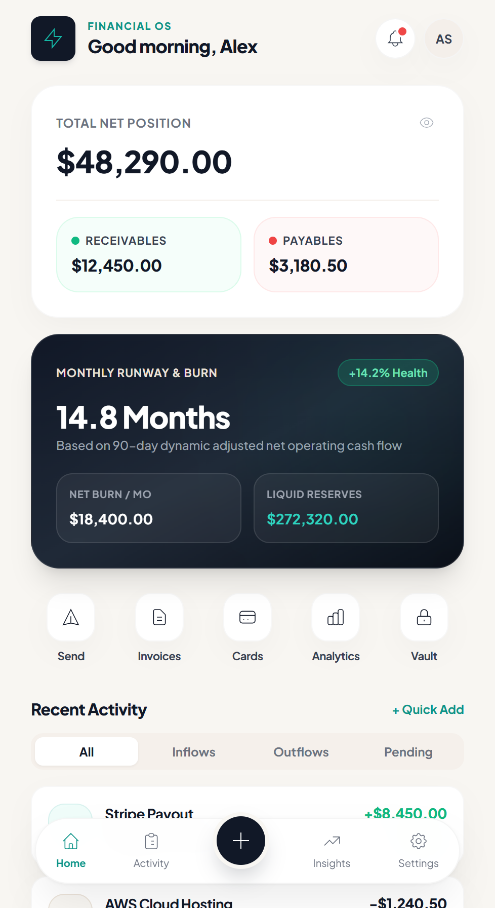
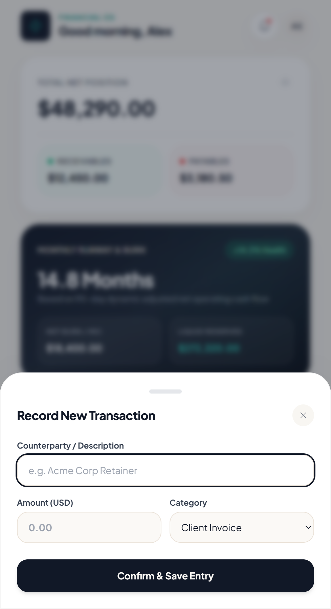
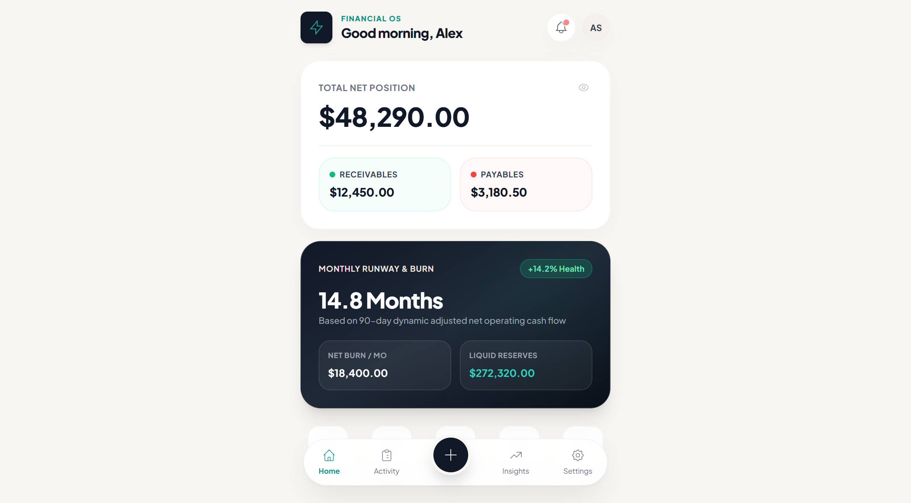

# SandSquircle UI — AI Agent Skill

[](https://opensource.org/licenses/MIT)
[](https://github.com/akbar-shaik/SandSquircle-UI-SKILL-AI)
[](https://github.com/akbar-shaik/SandSquircle-UI-SKILL-AI)
[](https://github.com/akbar-shaik/SandSquircle-UI-SKILL-AI)

> **Universal, installable AI Agent Skill enabling any AI coding assistant to design, scaffold, and refactor WebUI, Mobile Apps, and Desktop Applications into the signature SandSquircle design system.**

---

## 📸 Visual Showcase

<p align="center">
  
  &nbsp;&nbsp;&nbsp;&nbsp;
  
</p>

<p align="center">
  
</p>

---

## 🎨 Design Philosophy & Cardinal Rules

**SandSquircle** is a daylight-first, high-contrast interface design system inspired by tactile physical cards floating on a warm earthen foundation.

1. **Warm Daylight Canvas (`#F8F6F2`)**: **Never** use pure `#FFFFFF` for the viewport background. The screen canvas is always Warm Sand (`sand-100`), allowing crisp white cards and floating pill docks to sit with natural optical depth.
2. **Omni-Platform Responsive Shell**:
   - **Mobile Web & PWAs**: Centered handheld container (`max-w-[460px] pb-28 mx-auto`) with bottom pill dock navigation.
   - **Desktop Web Apps & Admin Dashboards**: Expands seamlessly to a multi-column enterprise layout with squircle sidebar navigation and responsive stat grids.
   - **Native Mobile Apps**: Native view containers with continuous squircle curvature for Android, iOS, React Native, and Flutter.
3. **Ultra-Diffused Elevation & Hairline Borders**: Every white surface uses `rounded-[26px]`, ambient shadow `0 10px 30px -4px rgba(0, 0, 0, 0.04)`, and a 1px `border-black/[0.03]` hairline border. Never use heavy gray borders or harsh drop shadows.
4. **High-Contrast Interactive Hierarchy**: Deep Charcoal (`#111827`) provides decisive authority for headings, hero cards, and primary CTAs, accented with vibrant Teal (`#0D9488`) for active navigation states.

---

## ⚡ 1-Line Installation for All Major AI Agents

### 1. Google Antigravity IDE

**Global Installation (All Workspaces):**
```bash
# Linux / macOS:
curl -fsSL https://raw.githubusercontent.com/akbar-shaik/SandSquircle-UI-SKILL-AI/main/install.sh | bash

# Windows PowerShell:
irm https://raw.githubusercontent.com/akbar-shaik/SandSquircle-UI-SKILL-AI/main/install.ps1 | iex
```

*Or via direct git clone:*
```bash
git clone https://github.com/akbar-shaik/SandSquircle-UI-SKILL-AI.git ~/.gemini/antigravity/skills/sandsquircle
```

**Project-Level Installation (Current Workspace Only):**
```bash
# Linux / macOS:
./install.sh --local

# Windows PowerShell:
.\install.ps1 -Local
```

---

### 2. Claude Code (`claude-code`)

Clone directly into your personal Claude Code skills directory:
```bash
git clone https://github.com/akbar-shaik/SandSquircle-UI-SKILL-AI.git ~/.claude/skills/sandsquircle
```
*Or add to your project's `CLAUDE.md`:*
```markdown
## Design System
Follow the SandSquircle UI skill instructions in `.agent/skills/sandsquircle/SKILL.md`.
Always use Warm Sand (#F8F6F2) background, 26px soft-squircle cards, and Charcoal (#111827) typography.
```

---

### 3. Cursor & Cursor Cloud Agents

Add SandSquircle as a project rule:
```bash
mkdir -p .cursor/rules
curl -fsSL https://raw.githubusercontent.com/akbar-shaik/SandSquircle-UI-SKILL-AI/main/SKILL.md -o .cursor/rules/sandsquircle.mdc
```
Cursor automatically discovers and activates the skill whenever you mention UI redesigns, cards, or SandSquircle.

---

### 4. Windsurf

Add SandSquircle to your project rules:
```bash
curl -fsSL https://raw.githubusercontent.com/akbar-shaik/SandSquircle-UI-SKILL-AI/main/SKILL.md >> .windsurfrules
```

---

### 5. GitHub Copilot, Cline, Roo Code & Aider

Clone the skill into your project root:
```bash
git clone https://github.com/akbar-shaik/SandSquircle-UI-SKILL-AI.git .agent/skills/sandsquircle
```
Then instruct the agent:
> *"Read `.agent/skills/sandsquircle/SKILL.md` and use the SandSquircle UI design system for this task."*

---

## 📱 Multi-Platform Architecture

| Target Platform | Technology | Reference Implementation |
| :--- | :--- | :--- |
| **Modern WebUI** | React / Next.js / Vue / Svelte / Tailwind | [`references/tailwind.config.js`](references/tailwind.config.js) & [`references/component-recipes.tsx`](references/component-recipes.tsx) |
| **Vanilla Web** | HTML / HTMX / PHP / Django / Rails | [`references/sandsquircle-tokens.css`](references/sandsquircle-tokens.css) |
| **Android Native** | Kotlin / Jetpack Compose Material 3 | [`references/ComposeTheme.kt`](references/ComposeTheme.kt) |
| **iOS Native** | Swift / SwiftUI (Continuous Squircles) | [`references/SandSquircleTheme.swift`](references/SandSquircleTheme.swift) |
| **Cross-Platform Mobile** | React Native / Expo | [`references/ReactNativeTheme.ts`](references/ReactNativeTheme.ts) |
| **Cross-Platform Mobile** | Flutter (Material 3 ThemeData) | [`references/sand_squircle_theme.dart`](references/sand_squircle_theme.dart) |
| **Desktop Web & Enterprise** | Multi-Column Dashboard / Electron / Tauri | [`references/component-recipes.tsx`](references/component-recipes.tsx) (`SandSquircleDesktopShell`) |
| **Universal Design Tokens** | W3C DTCG Format (Figma / Tools) | [`references/tokens.json`](references/tokens.json) |

---

## 🚀 Triggering the Skill in AI Prompts

Once installed, use natural language triggers with your AI assistant:

### WebUI & Single-Page Apps
> *"Use the sandsquircle skill to design a fintech dashboard with TopBar, Light Hero Balance Card, and Floating Pill Dock in Next.js."*

### Mobile Applications
> *"Apply the SandSquircle SwiftUI theme from SandSquircleTheme.swift to my iOS banking app."*
>
> *"Refactor my Android home screen with ComposeTheme.kt and Modifier.sandSquircleCard()."*
>
> *"Scaffold a React Native screen using SandSquircleStyles and PressableScale."*

### Desktop Web Apps & Admin Dashboards
> *"Scaffold an enterprise admin portal using the SandSquircleDesktopShell with collapsible sidebar and SandSquircleStatGrid."*

---

## 🎨 Color Palette & Design Tokens

### 1. Sand Canvas Foundation
| Token | Hex Value | Usage |
| :--- | :--- | :--- |
| `sand-50` | `#FBF9F6` | Form input backgrounds & sub-panels |
| `sand-100` | `#F8F6F2` | **Primary Viewport / Screen Background** |
| `sand-200` | `#F4EFEA` | Subtle dividers and pill tracks |
| `sand-300` | `#EAE2D8` | Active borders and tab segments |
| `sand-400` | `#D8CDC0` | Disabled borders & hairlines |

### 2. Charcoal Ink Hierarchy
| Token | Hex Value | Usage |
| :--- | :--- | :--- |
| `charcoal-900` | `#111827` | Primary typography, FAB, key CTAs |
| `charcoal-800` | `#1F2937` | Dark card gradient termination |
| `charcoal-700` | `#374151` | Section titles & form labels |
| `charcoal-500` | `#6B7280` | Subtitles, timestamps & inactive icons |
| `charcoal-200` | `#E5E7EB` | Hairline dividers |
| `charcoal-100` | `#F3F4F6` | Pill backgrounds |

### 3. Brand Teal & Semantic Status
| Semantic Role | Text | Background | Border |
| :--- | :--- | :--- | :--- |
| **Brand Teal Accent** | `#0D9488` | `#F0FDFA` | `#CCFBF1` |
| **Paid / Inflow (Emerald Mint)** | `#10B981` | `#ECFDF5` | `#D1FAE5` |
| **Overdue / Outflow (Crimson Coral)** | `#EF4444` | `#FEF2F2` | `#FEE2E2` |
| **Pending / Warning (Amber Sand)** | `#F59E0B` | `#FFFBEB` | `#FEF3C7` |

---

## 📐 Corner Radius Hierarchy

```
┌──────────────────────────────────────────────┐
│  Modals & Bottom Sheets: 32px (rounded-[32px])│
│  ┌────────────────────────────────────────┐  │
│  │ Dark Hero Cards: 28px (rounded-[28px]) │  │
│  │  ┌──────────────────────────────────┐  │  │
│  │  │ Primary Cards: 26px              │  │  │
│  │  │  ┌────────────────────────────┐  │  │  │
│  │  │  │ Mini-Cards: 22px           │  │  │  │
│  │  │  │  ┌──────────────────────┐  │  │  │  │
│  │  │  │  │ Rows/Inputs: 16px    │  │  │  │  │
│  │  │  │  │  ┌────────────────┐  │  │  │  │  │
│  │  │  │  │  │ Tabs: 12px     │  │  │  │  │  │
│  │  │  │  │  └────────────────┘  │  │  │  │  │
│  │  │  │  └──────────────────────┘  │  │  │  │
│  │  │  └────────────────────────────┘  │  │  │
│  │  └──────────────────────────────────┘  │  │
│  └────────────────────────────────────────┘  │
└──────────────────────────────────────────────┘
  Floating Pill Dock & FAB: 9999px (rounded-full)
  App Brand Icon: 22% (rounded-[22%])
```

---

## 🖥 Interactive Preview

To run the interactive live preview:
1. Double click [`examples/demo-preview.html`](examples/demo-preview.html) in any web browser.
2. Experience live balance privacy toggling, category tabs, and animated bottom-sheet modals with zero build steps or npm installations.

---

## 📄 License

Distributed under the [MIT License](LICENSE).
Built with passion for autonomous AI agents and high-velocity product teams.
